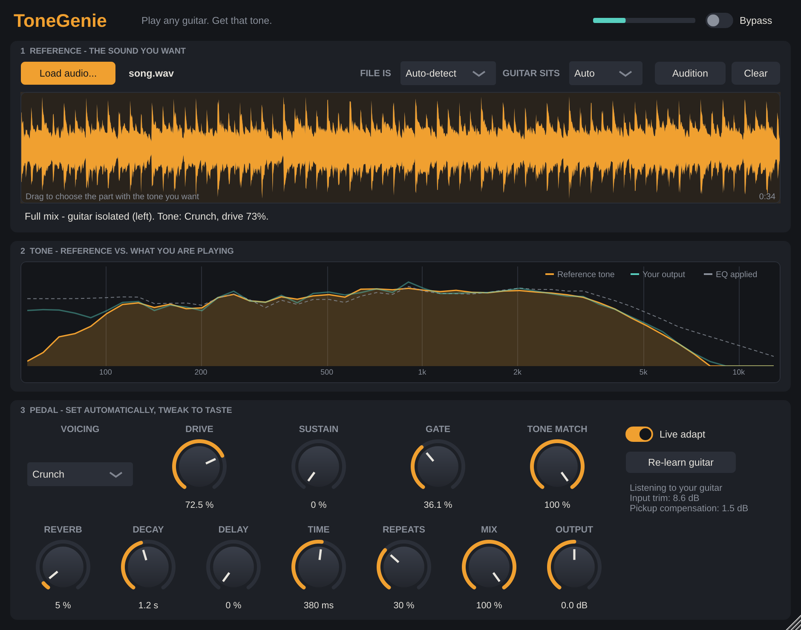

# ToneGenie

**Give it a recording. Play a clean guitar. Get that tone.**

ToneGenie is an audio effect plugin. You hand it an audio file - a lone guitar track or a
complete song - and it works out what the guitar in it sounds like, sets itself up as a
"pedal" that produces that sound from a clean guitar, and then keeps adjusting to whatever
guitar you actually plug in so the result stays on target.



## What it does

1. **Listens to the file.** It decides whether the file is just a guitar or a full mix.
2. **Finds the guitar.** In a full mix it first looks for passages where the guitar plays
   on its own (intros, breaks) and uses those directly. Otherwise it separates the guitar
   from the mix by its stereo position and by removing drums, bass and vocals.
3. **Measures the tone**: the long-term spectrum (amp, cabinet, mic), how saturated the
   signal is, how long notes sustain, and how much reverb is on it.
4. **Sets the pedal.** It plays a model clean guitar through its own drive stage at many
   settings and keeps the setting that measures closest to the reference
   (voicing, drive, sustain, gate, reverb), then builds a matching EQ on top.
5. **Adapts while you play.** It learns the level and brightness of your instrument and
   continuously corrects for them, so single coils, humbuckers, hot or weak pickups all
   arrive at the same sound. Switch *Live adapt* off to freeze the correction.

Everything it learned is saved with your DAW project; the audio file is not needed again.

## Using it

1. Put ToneGenie on a track with a clean (DI) guitar - straight from the interface, no amp sim.
2. Drop an audio file on the plugin (WAV, AIFF, FLAC, MP3, Ogg; plus AAC/M4A on macOS
   and WMA on Windows), or click **Load audio...**.
3. Wait a few seconds for the analysis, then play. Give it a few bars to learn your guitar.

Getting the best match from a full song:

- **Drag across the waveform** to select the part with the tone you want (the solo, the
  intro riff). Double-click to clear the selection.
- **Audition** plays the guitar signal the tone was taken from. If you can hear a lot of
  other instruments in it, pick a different passage or tell ToneGenie where the guitar
  sits with **Guitar sits: Left / Centre / Right**.
- **File is** overrides the automatic guitar-only / full-song decision. If ToneGenie
  picked an "exposed" passage that is not actually the guitar (a piano intro, say), choose
  *Full song* to make it separate the guitar from the mix instead, or select the right part.
- All pedal controls stay live: if the detected drive is not quite right, turn the knob.
- **Re-learn guitar** after swapping instruments or pickups.

| Control | What it does |
| --- | --- |
| Voicing | Smooth (mid-focused overdrive), Crunch (two-stage amp-style gain), Fuzz (hard, asymmetric) |
| Drive | Amount of saturation |
| Sustain | Compression in front of the drive stage |
| Gate | Noise gate, scaled to your instrument's level |
| Tone Match | How much of the matching EQ is applied (0 % = raw drive stage) |
| Reverb / Decay, Delay / Time / Repeats | Ambience after the tone stage |
| Mix, Output | Dry/wet (latency compensated) and output level |
| Live adapt | Keep correcting for the instrument being played |

## Downloads and installation

The GitHub Actions workflow in this repository builds, tests and packages:

| Platform | CPU | Formats |
| --- | --- | --- |
| macOS 10.15+ | Apple Silicon + Intel (universal) | VST3, AU, CLAP, Standalone |
| Windows 10/11 | x64 | VST3, CLAP, Standalone |
| Windows 11 | ARM64 | VST3, CLAP, Standalone |
| Linux | x86_64 | VST3, LV2, CLAP, Standalone |
| Linux | aarch64 | VST3, LV2, CLAP, Standalone |

Download the build for your system from the **Actions** tab (latest successful run ->
Artifacts), or from **Releases** once a version tag has been pushed. Where to copy the
files is described in [`packaging/INSTALL.txt`](packaging/INSTALL.txt), which is also
included in every download.

DAW coverage: VST3 covers Ableton Live, Cubase, FL Studio, Studio One, REAPER, Bitwig and
most others; AU covers Logic Pro and GarageBand; CLAP and LV2 cover the rest.
**Pro Tools** only loads AAX plugins, which must be signed with Avid's tools: the build
has an opt-in `-DTONEGENIE_BUILD_AAX=ON` switch, but producing a usable AAX needs an Avid
developer account. The macOS builds are not notarised and the Windows builds are not
code-signed (see `INSTALL.txt` for the one-time macOS step).

## How well does it work? (read this)

"Exactly that tone" is the goal, not a guarantee. What to expect:

- **Spectrum** (the amp/cab/mic character) is matched closely. In the automated tests a
  different, much quieter guitar lands within about 1 dB (average, 100 Hz - 5 kHz) of the
  reference's long-term spectrum, and output loudness stays within 1 dB across inputs
  that differ by 34 dB.
- **Gain / saturation** is estimated from the recording (waveform crest factor, sustain,
  dynamics). It reliably tells clean from crunchy from high-gain, but it is an estimate:
  expect to nudge *Drive* sometimes. Voicing is chosen from three generic circuits - it is
  not a component-level model of any particular amp or pedal.
- **Guitar isolation** uses classic signal processing, not a neural network. It works
  well when the guitar is panned to one side or exposed somewhere in the song, and poorly
  when the guitar sits dead-centre under vocals in a dense mix - then select a passage
  where the guitar is exposed, or use an isolated stem from a dedicated stem separator.
- **Effects** beyond drive, EQ, compression and reverb (wah, chorus, phaser, pitch
  effects, delays) are not detected. Delay is available but set by hand.
- A tone also depends on the player, the pickup position and the part being played.
  ToneGenie makes the *signal chain* match; it cannot make chords sound like single notes.

All measurements above come from synthetic test material (modelled guitars, amps and
mixes) - see `tests/`. The detector has not been tuned against a large set of commercial
recordings.

## Building from source

Requirements: CMake 3.22+, a C++17 compiler (Xcode 12+, Visual Studio 2022, GCC 9+ or
Clang 10+). JUCE is downloaded automatically at configure time.

On Linux first install the development packages:

```bash
sudo apt-get install libasound2-dev libx11-dev libxext-dev libxrandr-dev libxinerama-dev libxcursor-dev libfreetype6-dev libfontconfig1-dev libgl1-mesa-dev
```

Then, on any platform:

```bash
cmake -S . -B build -DCMAKE_BUILD_TYPE=Release
```

```bash
cmake --build build --config Release --parallel
```

```bash
ctest --test-dir build -C Release --output-on-failure
```

The plugins end up in `build/plugin/ToneGenie_artefacts/Release/`. Useful options:

| Option | Default | Meaning |
| --- | --- | --- |
| `TONEGENIE_BUILD_PLUGIN` | `ON` | Build the plugin (off = DSP core, CLI and tests only, no downloads) |
| `TONEGENIE_BUILD_CLAP` | `OFF` | Also build the CLAP format (downloads clap-juce-extensions; the CI builds turn this on) |
| `TONEGENIE_BUILD_AAX` | `OFF` | Also build AAX (needs Avid signing to be loadable) |
| `TONEGENIE_COPY_AFTER_BUILD` | `OFF` | Install the plugins into your user plugin folders after building |
| `CMAKE_OSX_ARCHITECTURES` | `arm64;x86_64` | macOS architectures |

### Command-line tool

`tonegenie-cli` runs the same analysis and processing on WAV files, without a DAW:

```bash
./build/tonegenie-cli process reference.wav clean-guitar.wav output.wav --isolated what-it-heard.wav
```

With Visual Studio (or the Xcode generator) the tool is in a per-configuration folder:
`build\Release\tonegenie-cli.exe`.

## Project layout

```
core/      DSP library, plain C++17, no dependencies
  Reference   mix classifier, guitar isolation, the "analyse a file" pipeline
  Analysis    spectrum and saturation features, reverb estimate
  ToneFitter  analysis-by-synthesis search for the pedal settings
  FrontEnd    input leveler, pickup compensation, gate, compressor, oversampled drive
  MatchEq     adaptive minimum-phase matching EQ
  ToneEngine  the complete real-time effect
  Simd        SSE2 / NEON dot product used by the FIR filters
plugin/    JUCE plugin: parameters, state, background analysis, editor
tools/     command-line tool
tests/     core test suite and an end-to-end test of the plugin class
```

Real-time notes: the audio thread never allocates or locks - it only filters and passes
data through atomics. Spectrum analysis and filter design for the matching EQ run on a
helper thread. CPU use is about 1.5 % of one core at 48 kHz (measured on a desktop x86-64
machine). Reported latency is 32 samples (the oversampler); the matching EQ itself is
minimum-phase and adds none.

## Licensing note

ToneGenie's own code has no licence file yet - add the one you want. Be aware that the
plugin is built on [JUCE](https://juce.com), which is dual-licensed (AGPLv3 or a commercial
JUCE licence): distributing binaries means complying with one of the two. The CLAP build
additionally uses [clap-juce-extensions](https://github.com/free-audio/clap-juce-extensions) (MIT).
